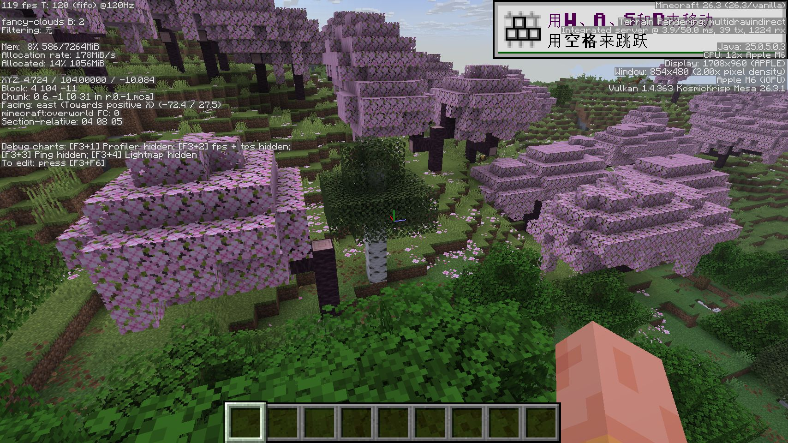

# Running Desktop OpenGL on macOS with Zink + KosmicKrisp

2026-11-26

Notes on getting desktop OpenGL running on Apple Silicon macOS via `Zink (Mesa Gallium, GL → Vulkan) → KosmicKrisp (Vulkan → Metal 4) → Apple Silicon GPU`: the chain, what others have already done, and what is still missing before anyone starts real work.

Where I'm coming from: I don't own a Mac and I've never written a Mesa driver. What follows is assembled from other people's MRs, findings, gists and disassembly, plus a screenshot someone else provided. Anything I haven't run myself is attributed; version numbers, CTS counts and patch numbers come from first-hand records, and I'll correct anything I got wrong. This document stands on the work of the people listed below, not on me.

I'm publishing it to find three kinds of people: anyone with an Apple Silicon machine willing to send back a `vulkaninfo` dump and the fixed sample results in Appendix C; shaderpack authors who can say whether GS in their pack is a hard or soft dependency; and the authors of the material listed below — if I've misrepresented something, or if you'd like to cross-link your findings, just say so in your own repo or here. No project to join, no single line to toe. Work separately and put results somewhere public.

Bottom line: the chain works, but current release builds are not an out-of-the-box feature. The first two gates are `geometryShader` and transform feedback, neither in the SDK; 4.x above that also waits on a set of Hadron patches. None of it is an architecture problem.

The text and my own analysis are released under **CC BY 4.0**: repost, split, rewrite, just credit the source. Third-party material is used only for factual citation and links and remains with its respective authors; what is and isn't bundled, and why, is in `CREDITS_AND_LICENSE_en.md`. The Chinese version is `Zink_KosmicKrisp_on_macOS_zh.md`.

---

## Why this came up

Apple's OpenGL has been frozen at 4.1 since 2013 and was deprecated in 2018. Everything from GL 4.2 on — compute, SSBO, indirect draw, transform feedback, the geometry stage — is absent from the native stack. The same silicon reports GL 4.6 under Asahi Linux, so the problem is the driver, not the hardware.

It isn't only games. The Blender developer portal has a KosmicKrisp page: it runs from 5.1 and lists limitations one by one — GS unsupported, shaders sometimes failing to compile, `setup-env.sh` still defaulting to MoltenVK so you have to set `VK_DRIVER_FILES` by hand. The page explicitly says this is a convenience for developers switching between Metal and Vulkan on one machine, not something intended for official releases. On the shaderpack side, OptiFine gets only 8 color textures on macOS; Iris can offer 16 buffers but is still stopped at the driver. Shaderpack authors say GS is effectively required for voxel-related shaders.

Minecraft Java is just the handiest sample. Native Vulkan was the default only in the 26.2 snapshot window; the 26.2 release switched back to OpenGL. Iris itself remains OpenGL-only, so GL 4.x-dependent shaderpacks and mods have no second path. The GL path also covers older versions with no native backend at all. Take the actual default from `options.txt` and F3; HMCL's modelling is only a cross-check.

On 25 November Khronos deprecated MoltenVK and wound down the Portability Initiative; `VK_KHR_portability_subset` is being removed from the spec and headers, and MVK gets no new extensions. KosmicKrisp is a mainline Mesa driver: NIR to MSL, Metal 4, Vulkan 1.4 conformant, with LunarG CI running nightly CTS on M1/M2/M4. One side is frozen, the other is still moving.

---

## Prior work (chronological)

Everything here was thought of before, mostly by people who went deeper than these notes.

- **2026-04-08**: someone posted "Using kosmickrisp instead of moltenvk for vulkan in macos" on Minecraft Feedback. The reply was roughly "MVK is much faster right now, maybe in two or three years". Six months later GS landed in main; by late November Khronos deprecated MVK.
- **Mesa 26.0 cycle**: LunarG merged KK into mainline; it passed Vulkan 1.4 CTS in September 2026, announced by Khronos on 1 October. The architecture talk was XDC 2025: backend split out of NVK, started on Metal 3.1, `vk_meta` filling Metal gaps, NIR lowering. The "Our biggest issues while developing" slide — "Metal has no spec, samples are the only reference", "the MSL compiler crashes on uninitialised local arrays" — shows up again in other people's findings.
- **2026-08-31**: Mojira MC-311557 recorded 45+ `vkCmdBeginRendering` calls per frame in the 26.2 Vulkan backend, each turned by MVK into a separate `MTLRenderCommandEncoder`, repeatedly flushing tile memory on a TBDR GPU. Mojang closed it on 19 October under "only a bug if slower than OpenGL", with follow-up optimisation tracked internally. Treat it as evidence that the structural issue existed, not as current status.
- **2026-10-02/03/04**: Hadron, a macOS Windows-game compatibility layer (Wine + FEX + Metal), ran the full Khronos CTS suites — 3+ million Vulkan must-pass tests, 19,714 OpenGL 4.6 Khronos tests — and maintained Mesa patches numbered 0038–0083, with `findings.md`, `scripts/build-cts.sh`, and a list of things deliberately left for alpha.
- **2026-10-11**: Playport 0087 "OpenGL through Zink on the host" recorded the real ceiling at GL 3.3 (KK has no `shaderFloat64`); 0093 makes Zink report no fan support for KK, so gallium turns fans/quads into triangle lists on the CPU, Half-Life frame time 15.28ms → 1.59ms.
- **2026-10-29**: !44786 merged GS; XFB on !44928 was a draft at the time (marked ready for review in November, still unmerged).
- **Early November**: ScarletNX added `--vulkan_driver=kosmickrisp|moltenvk` runtime switching in #1206 with A/B numbers: one cutscene 55fps vs about 2fps on MVK (KK has `VK_EXT_conditional_rendering`, so occluded draws don't wait on the CPU), while another scene went the other way, 48–52 vs 27. The author wrote "one default driver is not the fastest everywhere".
- **2026-11-25**: Khronos deprecated MVK.

A few undated but closer-to-the-chain items: the GitHub Gist *Running Minecraft on macOS with Zink + KosmicKrisp* debugs through "problem one … problem ten" to 70fps; `pauyedin/kosmickrisp-minecraft-macos` on GitLab calls itself a "reproducible setup kit"; steamac carries 63 KK patches on the Venus host side; LunarG's October *State of Vulkan on Apple* gives the app bundle layout and the relative `library_path` form.

These records barely reference each other. The Gist author writes "maybe one day soon everything will just work", while in the same month Hadron had GL 4.6 CTS down to a single failure. On the same disk-cache bug the Gist disables the cache and pauyedin adds a driver build SHA and GPU name to the cache key. The gap is in archiving, terminology and hand-off.

---

## The chain, and two integration traps

```
GL app / shaderpack / mod
  → Zink (Mesa Gallium, GL → Vulkan)
  → libvulkan.1.dylib + KosmicKrisp ICD
  → KosmicKrisp (Vulkan → Metal 4)
  → Apple Silicon GPU
```

Capabilities are queried by Zink against the underlying driver using `VP_ZINK_requirements.json`. The querying party is Zink and the GLSL workload, not the application's own Vulkan extension whitelist.

The generic approach is to ship the loader and the KK ICD inside the app bundle, set `VK_DRIVER_FILES` (or `VK_ICD_FILENAMES`) per process, and on the GL side use `MESA_LOADER_DRIVER_OVERRIDE=zink` with bundled `libGL` / `libEGL`. LunarG's October write-up already draws the layout: dylibs in `Contents/Frameworks/`, json in `Contents/Resources/vulkan/icd.d/`, `library_path` as `"../../../Frameworks/libvulkan_kosmickrisp.dylib"`, and explicitly advises against installing the loader into `/usr/local/lib`. pauyedin's repo is a working kit. No need to design this layer from scratch.

Traps worth putting in any integration notes:

- `setup-env.sh` defaults to MoltenVK; override it explicitly.
- Two ICDs loaded at once segfault. When switching builds, either use a new process or make sure the old one is completely out of the search path.
- Use a relative `library_path` in the ICD json.

LWJGL-based applications (Minecraft Java among them) add one more layer: on macOS LWJGL first loads the MoltenVK inside its own natives artifact, which exports all loader entry points and can masquerade as the loader — at that point `VK_DRIVER_FILES` is never parsed. The official switch is `-Dorg.lwjgl.vulkan.libname=<absolute path to libvulkan.1.dylib>`; it usually has to be absolute because the loader may not be on the global library path. Order matters: switch to the real loader first, then set `VK_DRIVER_FILES`.

A few things from disassembling the client jar became implementation constraints:

- `VulkanBackend` calls `SDL_Vulkan_LoadLibrary(SharedLibrary.getPath())`, handing SDL the path LWJGL already loaded. At pc 99–113 it compares the two `vkGetInstanceProcAddr` addresses with `lcmp` and throws `BackendCreationException` plus an unload if they differ. Same library instance passes; mixing two drivers fails fast. Since an explicit path is passed, `SDL_VULKAN_LIBRARY` is out — the injection point has to be the LWJGL layer.
- `portability_enumeration` is first excluded during iteration, then added back conditionally on `IS_MACOS && available.contains(...)`; `portability_subset` belongs to `requiredIfExtensionsAvailableFeatureSets` and `createDevice` enables it only after `isSupported`. A conformant ICD reports neither, so both are skipped.
- Device selection filters by capability sets; no literal comparison on `deviceName` containing "MoltenVK" was found.
- Preflight failure is a **silent fallback to Apple GL with a normal main menu**. The picture looks fine and easily gets logged as "the new stack doesn't work". On real hardware, confirm the driver name first.

The disassembly started as an answer to "did MC hard-wire MVK?" Once someone in the community had it running, it became implementation material: the same native loading, address check and fallback semantics apply to the Zink chain too.

---

## "Upstream won't use those extensions, so adding them is pointless"

Inside an application's own native Vulkan backend, that's right. MC's `ppEnabledExtensionNames` is built only from Mojang's predefined FeatureSets — `requiredFeatureSets()` / `optionalFeatureSets()` in the disassembly are the whitelist — and `VkApplicationInfo.apiVersion` is pinned to 1.2. A hundred extra extensions advertised below won't be used up there.

The Zink chain has no such layer. Whether the GL side reports a given version is Zink comparing the driver's capability table tier by tier; whether a shaderpack written as `#version 330` with a geometry stage compiles depends directly on the `geometryShader` feature bit. One more bit below → one more tier of GL semantics → one more shader that produces a picture. By the same token "we have to wait for the application upstream to change code" doesn't hold: an OpenGL path plus replaced GL/EGL natives is enough, all process-local.

"If there's no clear performance win, don't do it" — agreed, but that governs whether users get a permanent toggle, not whether the research and tooling get built. What's recorded here is capability diffs, reproducible builds and regression cases, not an option that defaults to on.

---

## What Zink actually requires

`docs/drivers/zink.html` and `VP_ZINK_requirements.json` are the authoritative inputs. Zink raises the ceiling tier by GL version: any Vulkan gives 2.1 as a floor, each tier adds a set of requirements. The full table is in Appendix A; here are the ones that actually block:

- The **2.1 baseline** has a pile of extensions and features (six line features from `VK_EXT_line_rasterization`, `custom_border_color` with `customBorderColorWithoutFormat`, `provoking_vertex`, `robustness2` + `nullDescriptor`, …). Mesa notes these are not all validated: missing them doesn't lower the version, it produces rendering errors, validation errors, or crashes. A capability diff has to separate hard gates from unvalidated items.
- **3.0** needs `VK_EXT_transform_feedback` and `VK_EXT_conditional_rendering`.
- **3.2** needs `depthClamp`, `geometryShader`, `shaderTessellationAndGeometryPointSize`, `VK_EXT_depth_clip_enable`. Order matters: 3.0 requires XFB first, 3.2 requires GS second. Only when XFB is present and GS is missing does the ceiling stop at 3.1; missing both means 2.1. Shaderpacks written at 330+ fail to compile on either 2.1 or 3.1.
- **The GL 4.0 blocker differs by build; don't present the two as one answer.** The current `VP_ZINK_requirements.json`'s `gl40_baseline` lists `UNIFORM_TEXEL_BUFFER_BIT` on the three R32G32B32 formats and no `shaderFloat64`; Hadron 0054 fixed exactly that texel buffer and went from 3.3 to 4.6. Playport 0087's build records `shaderFloat64` (KK lacks the feature) as its 4.0 gate, so it stops at 3.3. Both are true of their own trees; always name the build.
- `VK_EXT_transform_feedback on pvr` in the Mesa 26.3 new-features list is the PowerVR driver, not kk.

No need to write a checker. `meson -Dtools=zink` produces `zink_check_requirements` (Mesa !36061): it runs each of the 22 compiled-in `VP_ZINK_*` profiles against the current device through `vpGetPhysicalDeviceProfileSupport`, printing `Supported` / `UNSUPPORTED` per profile. The highest Supported tier is the GL ceiling. It prints neither a version number nor a missing-item table; for missing items, compare `VP_ZINK_requirements.json` against `vulkaninfo` yourself (`tools/kkcap.py` covers the 20 key gates first). `vkprofiles` has no `--compare` subcommand; it only validates/transforms/combines profile files.

---

## Version bookkeeping

MR !44786 (`kk: Add geometry shader support`, Junmin Lee) was merged into main by Marge Bot at 2026-10-29 22:39 GMT+8. The merge brought in 6 commits, headed by `14f59d06` (`kk: Advertise geometryShader`); there is no separate merge commit. The MR page carries 15 pipelines (the last one green) and 40 comments. It wires up poly's existing lowering (the same one Honeykrisp uses) and also fixes adjacency index rewriting, tess→GS primitive ID, fence stripping after image stores, GS side effects moved into the compute pass, and exact-thread indirect dispatch. squidbus ran full CTS on an M4 Max with no failures; Mary Guillemard verified `primitive_id.matching` fixed on HK; Aitor Camacho reviewed-by and assigned the merge. In the discussion Willie Abrams said "I have transform feedback working on top of this MR" and opened !44928; it was a draft then, has since been marked ready for review, and is still unmerged at head `e56f2e43`.

Merged 29 October, 26.3.1 released 18 November — looks like it made the cut, but it didn't. Mesa cuts the feature release branch from main on the day of the first RC; after that 26.3.x only takes cherry-picked bugfixes: 10-14 rc1 (branchpoint) → 10-21 rc2 → 10-28 rc3 → 11-04 rc4/final → 11-18 26.3.1. GS landed two weeks after the cut. The 26.3.1 release notes say `New features: None`; searching the MR page for `26.3` / `backport` / `cherry` returns nothing. On the SDK side the newest is 1.4.363.1 (03 November patch release), 1.4.363.0 was 29 September. The SDK's KK is built from the `vulkan-sdk-1.4.363.0` branch whose VERSION is `26.3.0-devel`, so it has no GS either. No November SDK carries GS. Khronos says the next one is mid-December, mainly for removing the portability extensions; whether it includes `14f59d06` needs release notes or an actual `vulkaninfo` run.

The community F3 screenshot reads `Vulkan 1.4.363 KosmicKrisp` / `Mesa 26.3.1`. The first is the Vulkan API version the driver reports (it follows the Vulkan-Headers version Mesa was built against); the second is the Mesa build. Neither is the SDK package version, and neither implies the other's capabilities. The 26.3 branch was cut on 10-14 and GS merged on 10-29, so that machine has no GS; the F3 page does not show a GL version either.



The screenshot was provided by [Glavo](https://github.com/Glavo), maintainer of HMCL. The KosmicKrisp backend shown here is exposed by HMCL: the option is hidden by default, and HMCL only displays it and allows switching once KosmicKrisp has been installed on the system through a package manager. So this is not "install macOS and it just works", nor is it MC's own default backend.

Also readable: `Minecraft 26.3 (26.3/vanilla)`, `Java: 25.0.5.0.3`, `CPU: 12x Apple M6`, `GPU: Apple M6 (iGPU)`. The small text is transcribed in `evidence/F3_transcript_en.md` for searchability. The `119 fps T: 120 (fifo) @120Hz` on the left cannot be used as proof of "no fallback" — OpenGL runs at that rate too; the driver name on the right is what settles it.

Scope of use and takedown for the image: `CREDITS_AND_LICENSE_en.md`.

Keep three build variants (with B split into B and B+, the latter plus !44928), and always say which one a capability claim refers to:

- **A**: the KK inside SDK 1.4.363.1 (Mesa 26.3.0-devel), or Homebrew Mesa 26.3.1. The baseline for public claims; neither `geometryShader` nor XFB, GL 2.1.
- **B**: self-built Mesa main (with `14f59d06`). GS yes, XFB no; record the commit. Still GL 2.1.
- **C**: Mesa main plus the Hadron 0038–0083 patch series. GS and XFB both present, reports GL 4.6. This is a proper engineering record with `findings.md`, CTS scripts, owner decisions and a "deliberately left for alpha" list — just not on the SDK release line.

**Results from C must not be used to claim what A supports.** This goes in the document, the capability statement and the report template.

Known blemish: Aitor saw `dEQP-VK.spirv_assembly.instruction.graphics.float16.logical_nan.opfordequal_vector_geom` fail on M5 Pro / macOS 27, judged to be a Metal compiler bug absent on M3-4; M1 hadn't been run at the time. A separate group of CTS timeout cases was going to get its own spec/CTS issue, skipped in internal CI before the merge. Newer machines can't be assumed clean. GS is split into a compute pass that counts outputs and a rasterization VS that expands them, so the shader runs twice and frame-time shape differs from native GS.

---

## Where each existing record stands

The material is fairly complete — it's just scattered, mutually uncited, and inconsistent in terminology. Grouped by what we'd actually use it for:

**Gist, *Running Minecraft on macOS with Zink + KosmicKrisp*** is closest to this chain. It writes the debug as "problem one … problem ten": `DYLD_INSERT_LIBRARIES` plus `dlsym` interpose to route LWJGL's `glGenBuffers` into Mesa; GLFW hands you an `NSViewBackingLayer` so you have to swap in a `CAMetalLayer`, and it must be `dispatch_sync_f()` back to the main thread; `drawableSize` queried before CoreAnimation layout gives a 1×1 window; querying it from the render thread hits a CoreAnimation SIGBUS; process-specific PSO pointers stored in the disk cache crash Metal compilation on second launch, so the disk cache is simply disabled (loss described as negligible); the grey screen is MC drawing terrain with alpha=0 and the Metal compositor treating it as fully transparent, fixed by forcing 1.0 in the blit shader; black flicker frames come from format conversion via `vk_meta_blit`, switched to `util_blitter` at 2–3% cost; the tenth is window resizing not rebuilding the swapchain, fixed by adding a `KOPPER_METAL` branch to `zink_kopper_update`. Ends at 70fps with shader packs loading, the author calling it "held together with the most hackiest of hacks" and closing with "This at least proves that it can". Hotbar glitches, Voxy VERTEX compile failures and insufficient indirect features in KK are left unglossed at the end.

**Hadron's `findings.md` / conformance records** are the other end: forty-odd patches numbered 0038 to 0083, each with what changed and which tests it fixed. On M2 Pro / macOS 27, Vulkan must-pass 3,247,552 tests; OpenGL 4.6 Khronos from 19,714 tests / 15,296 pass / 6 fail to 15,304 pass / 1 fail; GL 4.2 compat and ES 3.1 / 3 / 2 all at 0 fail. The "Where it stands and what is left on purpose" section keeps sparse 3D (Metal mip tail bug), 124 fragment inputs vs the 128 GL 4.6 requires, and lost device with six processes sharing the GPU — each with why it's left for alpha. Its opening line belongs in our criteria: "A pass here does not mean a game works." Patches 0080–0083 aren't graphics at all anymore: `vkWaitForFences` hanging forever on device lost, a racy home-grown `pthread_barrier` since macOS lacks one, and two races between Zink's submit thread and buffer reads.

**Playport 0087 / 0093**: 0087 records the real ceiling at GL 3.3 (KK has no `shaderFloat64`); 0093 makes Zink report no fan support so gallium converts to triangle lists on the CPU, Half-Life 15.28ms → 1.59ms, power 4.66W → 2.85W. A "degraded" implementation in a translation layer isn't necessarily slower — useful for splitting sample groups.

**pauyedin's setup kit** turns several of those traps into something reproducible: `kk-launch.sh` runs as a Prism WrapperCommand in the java parent process (the author notes Prism's own Env field doesn't reach it), `VK_ICD_FILENAMES` sends only the game to KK while MoltenVK stays as the system default; 0001 fixes a black screen after long pauses because `kk_queue_submit()` didn't release the drawable after present, 0002 replaces IMMEDIATE with MAILBOX to kill flicker, 0003 builds a disk cache with a key of driver build SHA + GPU name, and 0021 adds an in-memory PSO cache keyed by blake3 of MSL source and pipeline state. Same cache bug: fixed here, disabled in the Gist.

**steamac** carries 63 KK patches on the Venus host side, adding GS, transform feedback, LINEAR render targets and single-texel alignment for DXVK / vkd3d-proton. LunarG's October *State of Vulkan on Apple* supplies the official bundle layout. Neither filling capabilities nor packaging is a new problem.

The "Apple macOS and MoltenVK" section of `docs/drivers/zink.html` still says only "Zink on macOS is experimental with very limited capabilities". That matches our framing as a reference implementation, disabled by default — and shows upstream docs haven't caught up with these records.

What's left to close: these results don't cite each other; several places say "GL 4.6" meaning different things — one is likely `MESA_GL_VERSION_OVERRIDE`, one is a main build that can't pass the 10-14 branch cut, one is the Hadron patch build — and nobody separates them; and there is a working but hidden-by-default internal implementation whose build scripts, injection flags and known limitations were never written down, so almost nobody besides its author can reproduce it.

---

## What to do (not done yet)

**Collect the existing work first.** On the public side, line up the Gist's ten problems, Hadron 0038–0083, pauyedin 0001–0003/0021 and Playport 0087/0093 as "different fixes for the same bug", marking which build each holds for. On the other side, get the branch, commit, build script, injection flags and known limitations of that hidden internal implementation, and write them into an `Existing implementation notes.md`. Keep the acceptance criterion plain: a second person, following the document on a Mac, can reproduce the launch. Also confirm it's really on the new stack — get a screenshot or log with the driver name, since a silent fallback also reaches the game. When unsure, ask those authors directly; it's cheaper than re-running everything. Don't move on until this is done.

**Then produce two builds.** A from the off-the-shelf SDK. B builds two things from Mesa main: KK (`-Dvulkan-drivers=kosmickrisp -Dgallium-drivers= -Dopengl=false`) and the Zink-side checker (`-Dgallium-drivers=zink -Dtools=zink`), in two separate build directories pinned to the same commit with a hash-stamped build ID. KK doesn't need `-Dmoltenvk-dir`. Keep C in a separate, separately labelled directory. One machine must switch between A and B with no residue, and the F3 driver name and `vulkaninfo` must agree afterwards. One open prerequisite: how many of Hadron's patches already landed in main decides whether B is "build main" or "build main plus patches" — see open questions.

**The capability diff is the first hard deliverable.** Save two `vulkaninfo --json` dumps, run `zink_check_requirements` to get the highest Supported tier, then compare `VP_ZINK_requirements.json` against that tier item by item (`tools/kkcap.py` gives a ✓/✗ pass over the 20 key gates first), and output a per-item table: which tier, which item is missing, hard gate or unvalidated item. Archive `kk.json` by chip / macOS / build version while you're at it; the public dumps are still mostly Mesa 26.0.0-devel.

**Fix the samples before running anything.** Ask the shaderpack authors one question: is GS in the pack a hard dependency (real `OpEntryPoint Geometry` / GLSL geometry stage / hard feature-bit check) or soft (only in advanced effects, with a compute/mesh fallback); and is XFB used to write back. Samples need at least two SSPT/voxel shaderpacks, one Voxy/DH-class mod, one workload with a real GS stage, one using only fixed-topology fans/quads (**listed separately** — 0093 shows this class can degrade to CPU, mixing it in pollutes the result), plus one non-game GL application (Blender-class). Locally extract each sample's `#version`, `OpEntryPoint Geometry`, `#extension` and feature references, and cross-reference them against the diff: "which item is missing / which file and where references it".

**Four-column criteria**: compiles / produces a picture / renders correctly / error type, per sample × per build, output as a pass-rate delta. Performance is the second track: 1% low, stutter spikes, shader warm-up time. The first thing on real hardware is always confirming no silent fallback.

**Real hardware comes from a community call.** Open to anyone stuck on Apple GL 4.1 and to developers, regardless of app, distribution or machine. The post should state experimental status, disabled by default, how to fall back to Apple GL, known rendering issues, that no personal data is collected, and that the three build variants must not be mixed. Report template in Appendix C. Aim for at least three chip / macOS combinations, including a recent machine to cover the float16 regression.

Public artefacts worth leaving behind, with existing foundations in parentheses: capability-diff CLI (extend Mesa !36061's `zink_check_requirements` with GL 2.1 unvalidated-item labels), macOS bundle template (LunarG layout and pauyedin's working kit exist; make a generic version without app-specific assumptions), reproducible build script (pin commit + hash ID), multi-machine capability database, CTS regression cases (continue Hadron's numbering), and a hard/soft/degradable three-state convention for shaderpacks. The first three are enough for someone else to pick it up.

---

## Known problems

1. `GL_VERSION` strings aren't trustworthy, and the three "4.6"s are three different things: Playport 0087 reports 3.3 blocked on `shaderFloat64`; the Gist's is confirmed to be `MESA_GL_VERSION_OVERRIDE=4.6` (it sets that and `MESA_GLSL_VERSION_OVERRIDE=460` in its environment block); Hadron's is what the profile really reports after 0054 fixed the R32G32B32 texel buffer, backed by 15,304 CTS passes. Trust only per-item results and actual shader compilation, and always carry the build ID when repeating a claim.
2. KK's disk shader cache once stored process-specific PSO pointers and crashed on second launch; switching builds can also pick up stale cache. The Gist disables the disk cache; pauyedin 0003 builds one with a driver build SHA + GPU name key and 0021 adds an in-memory PSO cache. Our approach: separate `MESA_SHADER_CACHE_DIR` by driver name + version, invalidate on switch, keep `MESA_SHADER_CACHE_DISABLE=true` for debugging. If enabling cache long-term, copy 0003's key scheme rather than inventing one.
3. `MESA_KK_EXPERIMENTAL` is read once per process and pollutes every Vulkan app in that process; don't enable it on users' behalf. Hadron 0064 already makes custom_border recognised by the Zink instance, so the flag isn't needed.
4. The correctness hacks: grey screen (alpha=0), black flicker frames (switch blit, 2–3%), partial rendering glitches, Voxy VERTEX compile failure. Record per sample.
5. The disassembly hit `OptionsForceDefaultGraphicsApiFix`, which may reset `preferredGraphicsBackend`. Don't rest the fallback path on a single config file.
6. No same-machine A/B against the Apple GL baseline for the double translation. 70fps is someone else's machine. The November driver-switch issue is the better reminder: one cutscene KK 55fps vs MVK about 2fps, another scene reversed at 48–52 vs 27. Split the performance track by scene.
7. Don't bet on upstream dates. Whether the next SDK carries `14f59d06` and when XFB merges are external variables; declare capabilities per bundled version.
8. SDL surface extension diffs and extension-whitelist blocking were worried about earlier and later ruled out by disassembly, real hardware and existing implementations.

---

## Open questions

- Whether build B produces a usable KK dylib on both macOS 26 and 27 — nobody has tried.
- The GL 4.0 blocker differs between the two public builds: Hadron records the R32G32B32 texel buffer, Playport records `shaderFloat64`; verify per target build rather than merging them into one answer.
- Whether !44928 actually reaches 3.3 once merged, and which Hadron patches are still needed for 4.x.
- Whether a pack with a real GS stage produces a picture on build B+ (with !44928) — currently a blank.
- Which of Hadron 0038–0083 already landed in Mesa main and which exist only in the project's own `patches/`. This decides how B is built and whether C's results can be migrated into B.
- Whether those authors want their findings gathered in one place, or at least cross-linked.
- If the samples turn out to be all hard dependencies and XFB has no path for a long time, close the implementation branch and keep the research conclusions rather than pretending it passed.

I haven't verified a single one of the above myself — especially the ones about real hardware, CTS and patch status, which could be entirely wrong. Trust the respective first-hand records, and feel free to edit this document directly.

---

## Appendix A · Zink requirements by GL version

Use `docs/drivers/zink.html` and `VP_ZINK_requirements.json` together. They don't fully overlap: for 2.1 the docs also list `VK_KHR_imageless_framebuffer` and `VK_EXT_provoking_vertex`, which the JSON's `gl21_baseline` does not; `zink_check_requirements` checks the profile, not the docs.

| Tier | Added requirements |
|---|---|
| 2.1 | Vulkan 1.0; `logicOp` `fillModeNonSolid` `alphaToOne` `shaderClipDistance` `independentBlend`; `VK_KHR_maintenance1/5`, `create_renderpass2`, `imageless_framebuffer`, `timeline_semaphore`, `dynamic_rendering`, `VK_EXT/KHR_robustness2` (+`nullDescriptor`), `VK_EXT_custom_border_color` (+`customBorderColorWithoutFormat`), `VK_EXT_provoking_vertex`, `VK_EXT_line_rasterization` (6 line features), `swapchain_mutable_format`, `border_color_swizzle`, `descriptor_update_template`; `VK_KHR_external_memory` (DRI); `scalar_block_layout` or Vk1.2 |
| 3.0 | `VK_EXT_transform_feedback`, `VK_EXT_conditional_rendering`; D32/D32_S8 format bits |
| 3.1 | `maxPerStageDescriptorSamplers ≥ 16`, `maxPerStageDescriptorUniformBuffers ≥ 13` |
| 3.2 | `depthClamp`, `geometryShader`, `shaderTessellationAndGeometryPointSize`, `VK_EXT_depth_clip_enable` |
| 3.3 | `dualSrcBlend`, `timestampComputeAndGraphics`, `VK_EXT/KHR_vertex_attribute_divisor`; A2R10G10B10-class vertex buffer formats |
| 4.0 | `sampleRateShading` `tessellationShader` `imageCubeArray`, `VK_KHR_maintenance2/3/4`; R32G32B32 formats with `UNIFORM_TEXEL_BUFFER_BIT` |
| 4.1 | `multiViewport`; min maxImageDimension1D/2D/3D/Cube, maxImageArrayLayers, maxViewports |
| 4.2 | `shaderStorageImageExtendedFormats` `shaderStorageImageWriteWithoutFormat`; `shaderDrawParameters`, `vertexPipelineStoresAndAtomics`, `fragmentStoresAndAtomics`; `VK_EXT_image_2d_view_of_3d`; BC6/BC7 formats |
| 4.3 | `robustBufferAccess`, `robustImageAccess2`; `maxPerStageDescriptorUniformBuffers ≥ 15`, `maxComputeWorkGroupInvocations ≥ 1024`; format bits |
| 4.4 | B10G11R11 `VERTEX_BUFFER_BIT`; `VK_KHR_sampler_mirror_clamp_to_edge` or Vk1.2 `samplerMirrorClampToEdge` |
| 4.5 | `shaderCullDistance` |
| 4.6 | `samplerAnisotropy` `depthBiasClamp`, `VK_KHR_draw_indirect_count`, `VK_SUBGROUP_FEATURE_VOTE_BIT` |

## Appendix B · Commands

Generic (any GL app):

```bash
# 1) KK: the driver side of build B (separate build directory, not one command)
meson setup build-kk . --buildtype=release \
  -Dplatforms=macos \
  -Dvulkan-drivers=kosmickrisp \
  -Dgallium-drivers= \
  -Dopengl=false \
  -Dzstd=disabled \
  --prefer-static
ninja -C build-kk

# 2) Zink + checker: the GL side
meson setup build-zink . --buildtype=release -Dplatforms=macos \
  -Dgallium-drivers=zink -Dtools=zink
ninja -C build-zink

find build-kk -name '*.json' | grep -i -E 'icd|kosmic'

vulkaninfo --json > kk_B.json
./build-zink/src/gallium/drivers/zink/check_requirements/zink_check_requirements
# prints Supported / UNSUPPORTED per tier; the highest Supported tier is the GL ceiling

# relative library_path inside the ICD json
export VK_DRIVER_FILES=/path/inside/app/kk_icd.json
export MESA_LOADER_DRIVER_OVERRIDE=zink
export MESA_SHADER_CACHE_DIR=<isolated by driver name + version>
export ZINK_DEBUG=validation
export VK_LOADER_LAYERS_ENABLE=VK_LAYER_KHRONOS_validation

DYLD_PRINT_LIBRARIES=1
VK_LOADER_DEBUG=all
MESA_SHADER_CACHE_DISABLE=true
```

For LWJGL / Minecraft Java-class apps, add these — order matters:

```bash
-Dorg.lwjgl.vulkan.libname=/abs/path/libvulkan.1.dylib   # switch to the real loader first
VK_DRIVER_FILES=/path/to/kk_icd.json                     # then point at KK
```

## Appendix C · Report template

```
Environment
  Machine / macOS:
  Build ID:         A (SDK x.y.z) / B (main, commit=____) / C (patched, internal only)
  App & workload:   name + version + GL backend setting
  Injection:        generic bundle / LWJGL-class; libname=____ ; VK_DRIVER_FILES=____

Attachments
  full kk.json
  driver-name evidence (F3 / in-app driver info / log)
  profile diff output
  launch log (incl. silent fallback and enabled capability lines)

Four columns (per sample)
  sample | compiles | picture | renders correctly | error type
  SSPT / voxel pack A
  SSPT / voxel pack B
  real GS-stage workload
  fans/quads (separate row)
  Voxy / DH-class mod
  non-game GL app

Performance (second track, optional)
  Apple GL 4.1 baseline: avg fps / 1% low / stutter spikes / shader warm-up / VRAM
  Zink+KK:               same

Known issues
  [ ] grey screen  [ ] black flicker  [ ] partial rendering  [ ] crash on 2nd launch  [ ] silent OpenGL fallback
  [ ] float16...vector_geom regression (required on new machines / macOS 27)
Notes:
```

Strip usernames, absolute paths and any account info from logs before sending. Sending a report means you agree the capability data and test results may be aggregated publicly under CC BY 4.0 (excluding personal content in raw logs). If you'd rather not publish, a one-line "results not public, for verification only" is just as useful.

## Appendix D · What's in this package

The public release contains one F3 screenshot for the driver name, short citations, a transcript and original writing — no full-page archives, proprietary bytecode products or copied passages. The second table says where the originals live if you want to check them. The image is inlined with a relative path in "Version bookkeeping"; it renders when this file and `evidence/` sit side by side.

**Bundled**

| File | Contents |
|---|---|
| `CREDITS_AND_LICENSE_en.md` | licence for the text, third-party attributions, image scope, how to obtain non-bundled material, takedown channel |
| `evidence/screenshot_M6_F3_KosmicKrisp.jpg` | F3 screenshot on an M6, provided by [Glavo](https://github.com/Glavo), HMCL maintainer; confirms driver name and hardware, inlined above. The KK backend is exposed by HMCL and only shown / switchable once KK is installed through a package manager |
| `evidence/F3_transcript_en.md` | text transcript of the same lines, for search and copy |
| `evidence/MR44786_public_quotes_en.md` | shortest necessary quotes from the public MR page, each attributed |
| `evidence/how_to_reproduce_disassembly_en.md` | method and commands to generate the `renderpearl` disassembly; contains no output |

**Not bundled (and why)**

| Original | Where / how to get it | Why not |
|---|---|---|
| Full-page GitLab !44786 archive (`.mht`, with site CSS, avatars, UI text) | https://gitlab.freedesktop.org/mesa/mesa/-/merge_requests/44786 | Redistributing a whole page drags the site chrome and third-party assets along; the necessary facts are short-quoted in `evidence/MR44786_public_quotes_en.md` |
| 647-line plain-text extract of that page | same link, or save the page yourself | same reason; avoid a full-text copy |
| `renderpearl` disassembly (2457 lines) and its excerpt | generate yourself via `evidence/how_to_reproduce_disassembly_en.md` | derivative of proprietary game-client bytecode, not shipped; the text keeps conclusions and reproduction steps only |
| Earlier disassembly conclusion draft | not needed; corrected conclusions are in the main text and E.2 | it contained bytecode fragments and local paths, and several judgements were later disproved |

The quotes in Appendix E come from the public pages above; the main text paraphrases community results as facts and numbers only, without copying passages.

## Appendix E · Short public quotes and conclusions

Only the shortest necessary quotes from public pages; text remains with its respective speakers, full context at `https://gitlab.freedesktop.org/mesa/mesa/-/merge_requests/44786`. No disassembly output is pasted here; E.2 lists conclusions only, with reproduction steps in `evidence/how_to_reproduce_disassembly_en.md`.

### E.1 Mesa !44786

Page status and counts (commits / pipelines / comments checked against the GitLab API), plus the sentence that sets the framing:

```text
Merged
kk: Add geometry shader support
Junmin Lee requested to merge junminlee2004/mesa:kk-geometry into main
6 commits / 15 pipelines / 40 comments

"This MR adds geometry shader support to the KosmicKrisp Vulkan driver
 (mesa/mesa#14251) by wiring up poly's existing emulation used by
 Honeykrisp for KosmicKrisp."     — Junmin Lee, MR description
```

The description lists four additional changes (exact-thread indirect dispatch, adjacency index rewriting for pipelines without GS, tess→GS primitive ID, GS side effects running once and stripping the fence after image stores). "Version bookkeeping" paraphrases them as facts rather than copying the block.

Merge record (fast-forward, no separate merge commit):

```text
Merged by: Marge Bot (2026-10-29 22:39:18 GMT+8)
Changes from 14f59d06 merged into main. Source branch deleted.
14f59d06 - kk: Advertise geometryShader
Aitor Camacho assigned to @marge-bot
Marge Bot merged
```

Key commit titles (all six, in merge order):

```text
9a40f0c6 - kk: Add exact-thread indirect compute dispatch
5c145789 - kk: Implement geometry shaders with poly
531e208d - kk: Draw adjacency topologies without a geometry shader
d9d36e78 - poly: Strip KosmicKrisp image fences with geometry shader stores
2d817e53 - poly: Use the patch index as the geometry shader primitive ID
14f59d06 - kk: Advertise geometryShader
```

Comments that set the terminology:

```text
squidbus: As mentioned in the description, I ran full CTS on an M4 Max and did not
          encounter any failures.
Mary Guillemard: poly patch is Reviewed-by: Mary Guillemard
Aitor Camacho: Currently seeing a failure in
          dEQP-VK.spirv_assembly.instruction.graphics.float16.logical_nan.opfordequal_vector_geom
          with M5 Pro on macOS 27. I'll try to find some time to investigate, probably a
          Metal compiler bug not present in M3-4.
Aitor Camacho: Enabling geometryShader should be the last commit. Mostly to facilitate
          bisections in the future.
Junmin Lee: I've now removed the mentioned poly changes for a separate MR and reordered
          the commits so enabling GeometryShader is the last commit.
Willie Abrams: I have transform feedback working on top of this MR. Should I open it as
          a draft on top of this now, or wait until this lands?
Willie Abrams: Here is a draft: !44928 Implement VK_EXT_transform_feedback
Mary Guillemard: Working fine on HK and fixing
          dEQP-VK.geometry.builtin_variable.primitive_id.matching too:
          Reviewed-by: Mary Guillemard for poly patches.
```

### E.2 Disassembly conclusions (no bytecode)

The points in "The chain, and two integration traps" come from static analysis of game-client classes. The output is a derivative of proprietary bytecode and isn't shipped; generate it yourself via `evidence/how_to_reproduce_disassembly_en.md`. Conclusions only, for cross-checking:

- `VulkanBackend.loadLibrary()` passes `SharedLibrary.getPath()` (a runtime path, not a literal), then compares two `vkGetInstanceProcAddr` addresses and throws `BackendCreationException` plus unload if they differ.
- `VulkanBackend.createDevice()` enumerates the extensions the driver actually exposes, then runs `isSupported` over the required / requiredIfAvailable / optional groups, adding and logging `Enabling ... FeatureSet` only on success.
- `VulkanFeatureSets` has exactly three set methods; `optionalFeatureSets()` has exactly six entries: DXGI, Calibrated Timestamps, Wireframe, NV Diagnostic Checkpoint, AMD Buffer Marker, MultiDraw.
- `VulkanInstance` excludes `portability_enumeration` during iteration, then adds it back conditionally on `IS_MACOS && available.contains(...)`; a conformant ICD doesn't report it, so both are skipped.
- Preflight failure falls back silently.

Class names, method names and string constants are factual descriptions; no bytecode text is reproduced here. The earlier read-through (including a few later-disproved judgements) isn't bundled; corrected conclusions are in the main text and this section.

---

## Sources

First-hand records preferred, links where available. This document only cites facts and indexes pages; it copies no passages or full-page archives. Scope, licence and takedown: `CREDITS_AND_LICENSE_en.md`.

**Drivers and official**
- `VP_ZINK_requirements.json` / https://docs.mesa3d.org/drivers/zink.html ; Mesa !36061 https://gitlab.freedesktop.org/mesa/mesa/-/merge_requests/36061
- https://docs.mesa3d.org/drivers/kosmickrisp.html ; https://www.lunarg.com/products/kosmickrisp
- Khronos 1.4 conformance announcement https://www.khronos.org/news/archives/kosmickrisp-achieves-vulkan-1.4-conformance-on-apple-silicon ; XDC 2025 architecture slides https://www.khronos.org/developers/linkto/kosmickrisp-a-vulkan-to-metal-mesa-driver
- Mesa !44786 https://gitlab.freedesktop.org/mesa/mesa/-/merge_requests/44786 , !44928 https://gitlab.freedesktop.org/mesa/mesa/-/merge_requests/44928
- https://mesa3d.org/release-calendar.html , https://docs.mesa3d.org/releasing.html , https://docs.mesa3d.org/relnotes/26.3.1.html , mesa-announce, https://vulkan.lunarg.com/sdk/home
- Khronos 2026-11-25 *From Portability to Conformance* https://www.khronos.org/blog/from-portability-to-conformance-a-new-chapter-for-layered-vulkan-on-apple ; LunarG *The State of Vulkan on Apple – Oct. 2026* https://www.lunarg.com/the-state-of-vulkan-on-apple-oct-2026
- LWJGL `VK` / `Configuration.VULKAN_LIBRARY_NAME` docs, SDL3 `SDL_Vulkan_LoadLibrary`

**Community prior art**
- 2026-04-08 Minecraft Feedback https://feedback.minecraft.net/hc/en-us/community/posts/44920984456717-Using-kosmickrisp-instead-of-moltenvk-for-vulkan-in-macos
- Blender developer portal https://developer.blender.org/docs/features/gpu/vulkan/kosmic_krisp
- Mojira MC-311557 https://bugs.mojang.com/browse/MC-311557
- GitHub Gist *Running Minecraft on macOS with Zink + KosmicKrisp* https://gist.github.com/lucamignatti/5312f5e937de2ba44256ecba6de54cc2
- Hadron `conformance testing` / `findings.md` / `scripts/build-cts.sh`, patches 0038–0083, 2026-10-02/03/04 results https://github.com/IvanKarpan/hadron/blob/main/docs/conformance.md
- Playport 0087 "OpenGL through Zink on the host" https://github.com/playportdev/playport/blob/main/docs/decisions/0087-opengl-through-zink-on-the-host.md , 0093 https://github.com/playportdev/playport/blob/main/docs/decisions/0093-opengl-border-colours-and-fans-on-kosmickrisp.md
- GitLab `pauyedin/kosmickrisp-minecraft-macos` https://gitlab.com/pauyedin/kosmickrisp-minecraft-macos/-/tree/main
- steamac graphics-pipeline write-up (63 KK patches on the Venus host side)
- ScarletNX #1206 "Let a macOS run pick KosmicKrisp or MoltenVK" https://github.com/scarletnx/ScarletNX/issues/1206

**Local output**
- Conclusions of the `renderpearl` static analysis (folded into the main text and E.2); bytecode output not shipped, generation method in `evidence/how_to_reproduce_disassembly_en.md`
- F3 screenshot provided by [Glavo](https://github.com/Glavo), HMCL maintainer (`Vulkan 1.4.363 KosmicKrisp` / `Mesa 26.3.1`); both the image and the transcript are bundled. The backend is exposed by HMCL and only shown / switchable once KK has been installed through a package manager. Image scope: `CREDITS_AND_LICENSE_en.md`
