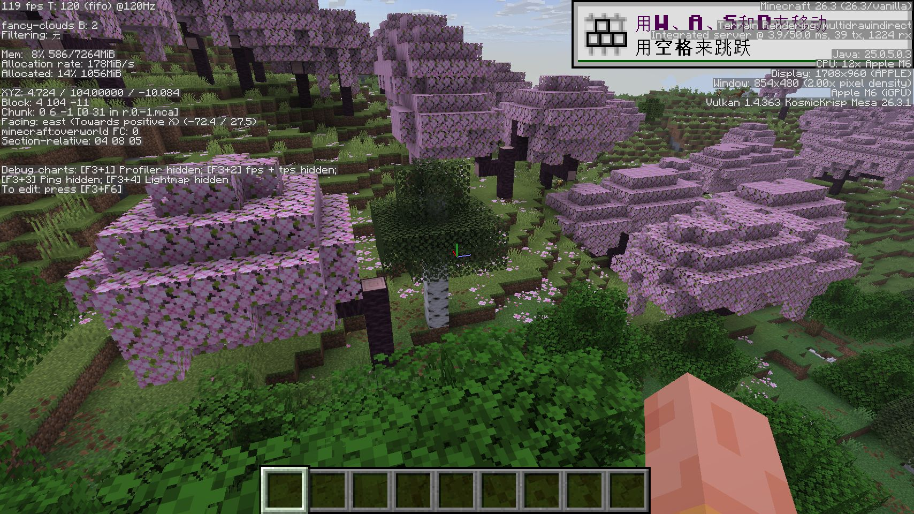

# 在 macOS 上用 Zink + KosmicKrisp 跑桌面 OpenGL

2026-11-26

记一下 Apple Silicon 的 macOS 上用 `Zink（Mesa Gallium，GL → Vulkan）→ KosmicKrisp（Vulkan → Metal 4）→ Apple Silicon GPU` 顶起桌面 OpenGL 这件事：链路、别人已经做到哪一步、真要动手还差什么。

先交代底细：我没有 Mac，也没写过 Mesa 驱动。下面的内容基本是读别人的 MR、findings、gist 和反汇编拼出来的，加上几张别人给的截图。凡是自己没跑过的都标了出处；版本、CTS 数字、补丁编号这类以一手材料为准，我转述错的地方直接改。这份东西能成立，靠的是下面列的那几拨人，不是我。

公开这份笔记是想找三类人：手上有 Apple Silicon 机器、愿意按附录 C 回传一份 `vulkaninfo` 和固定样本结果的；写光影包、能说清自己那个 pack 里的 GS 是硬依赖还是软依赖的；以及下面列到的那几份材料的作者——如果哪条转述错了、或者愿意把各自的 findings 互相挂个链接，直接在原仓库或这里指出就行。不要求谁加入什么项目，也不需要统一口径，各做各的、把结果放回公开处就够。

结论：链路是通的，当前发布版还不能当开箱功能发。系统 GL 4.1 已经有 3.2/4.0 的能力；这条链的收益是 4.2–4.6 的增量，但要先让 Zink 链从 2.1 爬到 3.3，再叠 Hadron 补丁到 4.6。不是架构问题。

本文正文和自写的分析稿按 CC BY 4.0 放出，可以转载、拆分、改写，标个出处即可。第三方材料只做事实性引用和链接，版权归各自作者；随包附了什么、没附什么、为什么，见 `CREDITS_AND_LICENSE_zh.md`。英文版是 `Zink_KosmicKrisp_on_macOS_en.md`，对应的许可说明是 `CREDITS_AND_LICENSE_en.md`。

---

## 起因

先厘清一个词：本文说「系统 GL」或「自带 GL」，指 macOS 的 OpenGL.framework，**不是硬件原生驱动**。Apple Silicon 上没有原生 OpenGL 驱动；版本串直接写 `4.1 Metal - ...`，即 Apple 自己的 GL 实现跑在 Metal 之上。

苹果的 OpenGL 从 2013 年起停在 4.1，2018 年标了 deprecated。系统 GL 4.1 的 3.2/4.0 能力已经在了；真正缺的是 GL 4.2 起的 image load/store、atomic counters，以及 4.3 的 compute、SSBO。同一块芯片 Asahi Linux 已经能报 GL 4.6，问题在驱动。

受影响的远不止游戏。Blender 开发者门户有一页 KosmicKrisp，5.1 起能跑，逐条列着 limitation：GS 不支持、shader 有时编译失败、`setup-env.sh` 默认配的还是 MoltenVK 得手动改 `VK_DRIVER_FILES`。页面上注了一句，这是给开发者在同一台机器上切 Metal/Vulkan 用的便利选项，没打算进正式发行。光影包这边，OptiFine 在 macOS 只有 8 个 color attachment，Iris 能用到全部 16 个 buffer；真正卡住 Iris 的是 4.3 的 compute/SSBO 那一批。

MC Java 只是手上最方便的样本。26.2 的快照窗口里原生 Vulkan 曾是默认，26.2 正式版又切回 OpenGL；Iris 本体仍是 OpenGL-only，官方目前把 Apple Silicon 列为不支持（驱动崩溃），依赖 GL 4.x 的光影没有第二条路。走 GL 路径还覆盖早期没有原生后端的版本。默认值以实机 `options.txt` 和 F3 为准，HMCL 代码里的建模只是旁证。

Khronos 在 11 月 25 日弃用 MoltenVK、收掉 Portability Initiative，`VK_KHR_portability_subset` 要从 spec 和 headers 里删掉，MVK 不再有新扩展。KosmicKrisp 是 Mesa 主线驱动，NIR 编到 MSL，Metal 4，Vulkan 1.4 conformant，LunarG 的 CI 在 M1/M2/M4 上跑夜间 CTS。

---

## 已有工作（按时间）

该想到的早有人想到了，而且大多做得比这份笔记深。

- **2026-04-08**，Minecraft Feedback 上有人发 "Using kosmickrisp instead of moltenvk for vulkan in macos"。回帖说 MVK 现在快得多，大概两三年后再说。半年后 GS 合进 main，十一月底 Khronos 把 MVK 弃用了。
- **Mesa 26.0 周期**，LunarG 把 KK 合进主线；2026 年 9 月过了 Vulkan 1.4 CTS，10 月 1 日由 Khronos 公告。架构演讲是 XDC 2025 那场：从 NVK 剥后端、Metal 3.1 起步、vk_meta 补 Metal 缺口、NIR lowering。Slides 里 "Our biggest issues while developing" 那页写的「Metal 没有 spec、samples 是唯一参考」「MSL 编译器会因未初始化局部数组崩」，后来在别人的 findings 里都碰到了。
- **2026-08-31**，Mojira MC-311557 记下 26.2 的 Vulkan 后端每帧 45+ 个 `vkCmdBeginRendering`，MVK 把每个转成独立 `MTLRenderCommandEncoder`，TBDR 上反复冲 tile memory。Mojang 10 月 19 日按「只在比 OpenGL 差时才算 bug」关掉了它，后续优化走内部跟踪，不当现状看。
- **2026-10-02/03/04**，Hadron 这个 macOS 上的 Windows 游戏兼容层项目（Wine + FEX + Metal）跑了整套 Khronos CTS，Vulkan must-pass 三百多万项、OpenGL 4.6 Khronos 19,714 项，按 0038–0083 编号维护 Mesa 补丁，有 `findings.md`、`scripts/build-cts.sh` 和一串「故意留给 alpha」的清单。
- **2026-10-11**，Playport 0087「OpenGL through Zink on the host」记下当时的真实天花板 GL 3.3（KK 没有 `shaderFloat64`）；0093 让 Zink 对 KK 不报 fan 支持，gallium 在 CPU 上把 fans/quads 转成三角形列表，Half-Life 单帧 15.28ms → 1.59ms。
- **2026-10-29**，!44786 合入 GS；!44928 的 XFB 当时还是 draft（2026-11 已转为待评审，仍未合入）。
- **11 月初**，ScarletNX 的 PR #1206 提了 `--vulkan_driver=kosmickrisp|moltenvk` 运行时切换，并附 A/B：某段 cutscene KK 55fps、MVK 约 2fps（KK 有 `VK_EXT_conditional_rendering`，遮挡 draw 不用 CPU 等）；另一个场景反过来，MVK 48–52fps、KK 27fps。作者写 "one default driver is not the fastest everywhere"。
- **2026-11-25**，Khronos 弃用 MVK。

还有几份没标日期但更贴这条链：GitHub Gist《Running Minecraft on macOS with Zink + KosmicKrisp》按「第一个问题…第十个问题」debug 到 70fps；GitLab 上 `pauyedin/kosmickrisp-minecraft-macos` 自称 "reproducible setup kit"；steamac 的 Venus host 侧给 KK 打了 63 个补丁；LunarG 十月《State of Vulkan on Apple》给了 app bundle 布局和 `library_path` 相对路径写法。

这些记录互相不引用。Gist 作者写「也许不远的一天一切都会正常」，同月 Hadron 已经把 GL 4.6 CTS 修到只剩一个失败；同一个磁盘缓存的坑，Gist 直接关掉，pauyedin 给缓存 key 加上 driver build SHA 和 GPU name。空隙在归档、口径和交接。

---

## 链路：打通后多出什么

```
GL 应用 / 光影 / 模组
  → Zink (Mesa Gallium, GL → Vulkan)
  → libvulkan.1.dylib + KosmicKrisp ICD
  → KosmicKrisp (Vulkan → Metal 4)
  → Apple Silicon GPU
```

能力是 Zink 按底层 Vulkan feature 逐项 gate 出来的；`VP_ZINK_requirements.json` 把这些要求按 GL 版本整理成 profile，给 `zink_check_requirements` 用。查询方是 Zink 和 GLSL 负载，不是上层应用那份 Vulkan 扩展白名单。

系统 GL 4.1 已经有 3.2/4.0 的能力；这条链要证明的不是重复这些，而是把 4.2–4.6 的增量重新暴露出来。C 构建（GL 4.6）相对系统 GL 4.1 多出的主要扩展：

| GL | 新增扩展 / 特性 | 对应用的意义 |
|---|---|---|
| 4.2 | `GL_ARB_shader_image_load_store`、`GL_ARB_shader_atomic_counters` | 影像读写、原子计数 |
| 4.3 | `GL_ARB_compute_shader`、`GL_ARB_shader_storage_buffer_object`、`GL_ARB_vertex_attrib_binding`、`GL_ARB_texture_view` | compute/SSBO（Iris 光影的关键）、DSA 前置、纹理视图 |
| 4.4 | `GL_ARB_buffer_storage`、`GL_ARB_multi_bind`、`GL_ARB_clear_texture` | 持久映射缓冲、批量绑定、清纹理 |
| 4.5 | `GL_ARB_direct_state_access`、`GL_ARB_clip_control`、`GL_ARB_derivative_control` | DSA、clip control、derivative control |
| 4.6 | `GL_ARB_indirect_parameters`、`GL_ARB_pipeline_statistics_query`、`GL_ARB_polygon_offset_clamp`、`GL_ARB_shader_draw_parameters` | 间接参数、管线统计、polygon offset clamp 等 4.6 核心项 |

这是 C 构建相对系统 GL 4.1 的增量。B+ 只到 3.3，仍低于系统 GL 4.1，不产生这些增量；A/B 更低。换句话说，这条链的可见收益要从 C 开始算。`GL_ARB_bindless_texture`、`GL_ARB_sparse_texture` 这类是 optional，不在 baseline 里，能不能用取决于 Zink/KK 的可选支持，别当默认。

通用做法是把 loader 和 KK 的 ICD 打进应用包，进程里设 `VK_DRIVER_FILES`（或 `VK_ICD_FILENAMES`），GL 侧 `MESA_LOADER_DRIVER_OVERRIDE=zink` 加自带的 `libGL` / `libEGL`。LunarG 十月那篇把目录画好了：`Contents/Frameworks/` 放 dylib，`Contents/Resources/vulkan/icd.d/` 放 json，`library_path` 写 `"../../../Frameworks/libvulkan_kosmickrisp.dylib"`，并说不推荐把 loader 装到 `/usr/local/lib`。pauyedin 那个仓库是现成可跑的 kit。这层不用另设计。

几个坑：

- `setup-env.sh` 默认配的是 MoltenVK，得显式覆盖。
- 两套 ICD 同时被加载会 segfault。切换构建要么换进程，要么确保旧的完全不在搜索路径里。
- ICD json 的 `library_path` 用相对路径。

LWJGL 类应用（MC Java 是其一）多一层：LWJGL 在 macOS 默认先加载自己 natives artifact 里的 MoltenVK，那份东西导出全部 loader entry points，能假装是 loader，`VK_DRIVER_FILES` 这时候不会被解析。官方切法是 `-Dorg.lwjgl.vulkan.libname=<libvulkan.1.dylib 绝对路径>`，常要绝对路径，因为 loader 不一定在全局 library path 里。顺序不能反：先切真 loader，再设 `VK_DRIVER_FILES`。

拆客户端 jar 得到的几条，后来成了实现约束：

- `VulkanBackend` 调 `SDL_Vulkan_LoadLibrary(SharedLibrary.getPath())`，把 LWJGL 已加载库的路径转交 SDL。pc 99–113 拿两边 `vkGetInstanceProcAddr` 的地址做 `lcmp`，不等就抛 `BackendCreationException` 并 unload。同一库实例就过，双驱动混用会 fail-fast。MC 传了显式 path，`SDL_VULKAN_LIBRARY` 走不通，注入点只能在 LWJGL 层。
- `portability_enumeration` 先在遍历里排除、再按 `IS_MACOS && available.contains(...)` 条件加回；`portability_subset` 归 `requiredIfExtensionsAvailableFeatureSets`，`createDevice` 里逐个 `isSupported` 才启用。conformant ICD 不报这两个，都跳过。
- 设备选择按能力集合筛，没看到按 `deviceName` 含 "MoltenVK" 做字面量比较。
- 预检失败是静默降级回苹果 GL、正常进主菜单。画面正常，很容易记成「新栈不行」。真机验证先确认驱动名。

反编译本来是回答「MC 有没有把 MVK 焊死」。后来社区里已经有人跑通，它就降成实现材料：同一套 native 装载、地址校验、降级语义，Zink 链照样要走。

---

## 「上游用不到那些扩展，加了也没用」

在应用自带的原生 Vulkan 后端里，这话对。MC 的 `ppEnabledExtensionNames` 只由 Mojang 预定义的 FeatureSet 构造，反汇编里 `requiredFeatureSets()` / `optionalFeatureSets()` 就是白名单，`VkApplicationInfo.apiVersion` 锁在 1.2。底层多宣告一百个扩展，那边也不会用。

Zink 链里没有这层。GL 侧报不报某个版本，是 Zink 拿驱动的能力表逐档比出来的；底层多一个 feature 位，GL 侧就多一档语义，就多一个能编译出画面的 shader。同理「得等应用上游改代码」也不成立，走 OpenGL 路径加替换 GL/EGL native 就够了。

「没有明显性能提升就不做」这条认，但它管的是要不要给用户一个常设开关，不是管要不要把调研和工具做出来。这里记的是差集数据、可复现构建和回归用例，不是一个默认打开的选项。

---

## Zink 到底要什么

`docs/drivers/zink.html` 和 `VP_ZINK_requirements.json` 是权威输入。Zink 按 GL 版本逐档抬：只要有 Vulkan 就保底 2.1，每档追加一组需求。完整表在附录 A，正文只写会卡人的位置：

- **2.1 基线**有一堆扩展和 feature（`VK_EXT_line_rasterization` 六个 line feature、`custom_border_color` 带 `customBorderColorWithoutFormat`、`provoking_vertex`、`robustness2` + `nullDescriptor`……）。官方自己注了：这些不全校验，缺了不会降版本，而是渲染出错、validation error，甚至崩。差集里得把硬门槛和未校验项分开标。
- **3.0** 要 `VK_EXT_transform_feedback`、`VK_EXT_conditional_rendering`。
- **3.2** 要 `depthClamp`、`geometryShader`、`shaderTessellationAndGeometryPointSize`、`VK_EXT_depth_clip_enable`。档位是累积的：低一档缺项，高一档也过不去。
- **4.0 的卡点随构建不同，不要并列当同一件事**：当前 `VP_ZINK_requirements.json` 的 `gl40_baseline` 列的是 R32G32B32 三格式的 `UNIFORM_TEXEL_BUFFER_BIT`，没有 `shaderFloat64`；Hadron 0054 修的正是这个 texel buffer，修完从 3.3 到 4.6。Playport 0087 那套构建记的是 `shaderFloat64`（KK 没这个 feature），所以停在 3.3。两份材料各自成立，引用时带构建。
- Mesa 26.3 新特性清单里 `VK_EXT_transform_feedback on pvr` 是 PowerVR 驱动，不是 kk。

检查工具不用自己写。`meson -Dtools=zink` 产出 `zink_check_requirements`（Mesa !36061）：它把编译进去的 22 个 `VP_ZINK_*` profile 逐个对当前设备跑 `vpGetPhysicalDeviceProfileSupport`，每个打印 `Supported` / `UNSUPPORTED`。它给的是**保守上限**，不是驱动实际报的 GL 版本，而且每个 GL profile 都包含 2.1 那一组：stock KK 的 `VK_EXT_custom_border_color` 藏在 `MESA_KK_EXPERIMENTAL=custom_border` 后面，不设这个变量，所有 GL profile 会一起 UNSUPPORTED。跑 checker 时设上它，并在结果里注明；只用于 checker，不要给实际应用开。设了也不保证 `gl21` 一定 Supported——2.1 profile 还要求 `VK_KHR_incremental_present` 等 WSI 项，实际版本仍以应用报的为准。它不打印版本号，也不打印缺项表；缺项要拿 `VP_ZINK_requirements.json` 对 `vulkaninfo` 自己比（`tools/kkcap.py` 可先把 20 个关键门槛过一遍）。`vkprofiles` 没有 `--compare` 子命令，它做的是 profile 文件的 validate / transform / combine 等。

---

## 版本口径

构建分三套（B 再分出叠了 !44928 的 B+），写能力结论时带上是哪套：

- **A**：SDK 1.4.363.1 里的 KK（Mesa 26.3.0-devel），或 Homebrew Mesa 26.3.1。对外承诺基线，GL 2.1（按 !44928 作者口径推算）。
- **B**：Mesa main 自编译（含 `14f59d06`），注明 commit；GL 仍是 2.1（同上）。
- **B+**：B 再叠 !44928，作者口径 3.3，仍低于系统 GL 4.1。
- **C**：Mesa main 加 Hadron 0038–0083 系列补丁，报 GL 4.6；相对系统 GL 4.1 多出 4.2–4.6 那批扩展。这套有 `findings.md`、CTS 脚本、owner 决策记录和「故意留给 alpha」清单，是正式工程记录，只是没进 SDK 发布线。

C 的结果不能拿去说 A 支持什么。另一个容易看岔的：B+ 的 3.3 仍低于系统 GL 4.1，这条链要真正超过系统 GL 栈，得走到 C。这两条都写进文档、能力声明和回传模板。

MR !44786（`kk: Add geometry shader support`，Junmin Lee）2026-10-29 22:39 GMT+8 由 Marge Bot 合进 main。合入的是 6 个 commit，head 为 `14f59d06`（`kk: Advertise geometryShader`），没有单独的 merge commit；MR 页面对应 15 条流水线（最后一条通过）和 40 条评论。实现接 poly 现成的 lowering（Honeykrisp 同源），顺带修了 adjacency 索引重写、tess→GS 的 primitive ID、image store 后的 fence 剥离、GS 的 stores/atomics 只保留一份（从 compute 副本里删掉）、exact-thread 间接 dispatch。squidbus 在 M4 Max 跑 full CTS 零失败，Mary Guillemard 在 HK 上验证修好 `primitive_id.matching`，Aitor Camacho reviewed-by 并指派合并。讨论里 Willie Abrams 说 "I have transform feedback working on top of this MR"，开了 !44928；当时是 draft，现在已转为待评审（ready），仍未合入，head `e56f2e43`。

10 月 29 合入、26.3.1 是 11 月 18 发的，看着像赶上了，其实没有。Mesa 的 feature release 在第一个 RC 那天就把分支从 main 切出来，之后 26.3.x 只收 cherry-pick 的 bugfix：10-14 rc1(branchpoint) → 10-21 rc2 → 10-28 rc3 → 11-04 rc4/final → 11-18 26.3.1。合入比切分支晚两周。26.3.1 release notes 写 `New features: None`；MR 页面全文搜 `26.3` / `backport` / `cherry` 零命中。SDK 侧最新 1.4.363.1（11 月初补丁版），1.4.363.0 是 9 月底；SDK 里的 KK 从 `vulkan-sdk-1.4.363.0` 分支编出，VERSION 是 `26.3.0-devel`，同样不含这个能力。11 月没有带这个能力的新 SDK。Khronos 说的下一版在 12 月中，主要做 portability 扩展移除，带不带 `14f59d06` 等 release notes 或实跑 `vulkaninfo`。

社区那张 F3 截图是 `Vulkan 1.4.363 KosmicKrisp` / `Mesa 26.3.1`。前一个是驱动报的 Vulkan API 版本（跟构建时用的 Vulkan-Headers 走），后一个是 Mesa 构建版本；两个都不是 SDK 包版本，也互不代表对方的能力。26.3 分支 10-14 就切了、GS 10-29 才合，所以那台机器不是 C 构建；这页也不显示 GL 版本。



图由 HMCL 维护者 [Glavo](https://github.com/Glavo) 提供。这里显示的 KosmicKrisp 后端由 HMCL 提供开启入口：该选项默认隐藏，只有在系统里通过包管理器装好 KK 之后，HMCL 才会把它显示出来并允许切换启用。所以它不是「装了 macOS 就自动能用」的状态，也不是 MC 自身的默认后端。

图上还能读到 `Minecraft 26.3 (26.3/vanilla)`、`Java: 25.0.5.0.3`、`CPU: 12x Apple M6`、`GPU: Apple M6 (iGPU)`。小字不便检索，逐字转录在 `evidence/F3_transcript_zh.md`。左上 `119 fps T: 120 (fifo) @120Hz` 不能当「没降级」的证据，OpenGL 也能跑这个数；定案靠的是右上那行驱动名。

图片的使用范围与撤回方式见 `CREDITS_AND_LICENSE_zh.md`。

已知瑕疵：Aitor 在 M5 Pro / macOS 27 上见 `dEQP-VK.spirv_assembly.instruction.graphics.float16.logical_nan.opfordequal_vector_geom` 失败，判断是 M3-4 上没有的 Metal 编译器 bug，当时 M1 还没跑。另有一组 CTS 超时用例拟另提 spec/CTS issue，合并前内部 CI 先 skip。

---

## 已有材料各自到了哪一步

材料留得挺全，散在各处、互不引用、口径乱。按实际会拿它们做什么分开记：

**Gist《Running Minecraft on macOS with Zink + KosmicKrisp》** 最贴这条链。按「第一个问题…第十个问题」写 debug：`DYLD_INSERT_LIBRARIES` 加 `dlsym` interpose 把 LWJGL 的 `glGenBuffers` 接到 Mesa；GLFW 给的是 `NSViewBackingLayer`，得自己换 `CAMetalLayer`，而且必须 `dispatch_sync_f()` 回主线程；`drawableSize` 没等 CoreAnimation layout 就被查，启动成 1×1 窗口；从渲染线程查尺寸撞上 CoreAnimation 的 SIGBUS；磁盘缓存里存了进程相关 PSO 指针，二次启动 Metal 编译崩，于是直接关掉磁盘缓存（损失 negligible）；灰屏是 MC 用 alpha=0 画地形、Metal compositor 当全透明，blit shader 里强改 1.0；黑闪帧是格式转换走了 `vk_meta_blit`，改走 `util_blitter`，代价 2–3%；第十个问题是窗口缩放不触发 swapchain 重建，补 `zink_kopper_update` 的 `KOPPER_METAL` 分支才修好。最后 70fps、shader pack 能加载，作者自己写 "held together with the most hackiest of hacks"，收尾 "This at least proves that it can"。hotbar 异常、Voxy VERTEX 编译失败、KK 没暴露够间接特性，都留在文末。

**Hadron 的 `findings.md` / conformance 记录** 是另一头：把 0038 到 0083 四十多枚补丁按编号配上改了什么、修了哪些测试。M2 Pro / macOS 27 上，Vulkan must-pass 3,247,552 项，OpenGL 4.6 Khronos 从 19,714 tests / 15,296 pass / 6 fail 修到 15,304 pass / 1 fail，GL 4.2 compat、ES 3.1 / 3 / 2 全 0 fail。「Where it stands and what is left on purpose」那节留了 sparse 3D（Metal mip tail bug）、fragment input 124 vs GL 4.6 要求的 128、六进程共享 GPU 的 lost device，每条写了为什么留给 alpha。开头一句该抄进判据："A pass here does not mean a game works." 0080–0083 修的已经不是图形问题了——`vkWaitForFences` 在 device lost 时永久挂住、macOS 没有 `pthread_barrier` 自己实现的有竞态、Zink 提交线程和读 buffer 之间的两个 race。

**Playport 0087 / 0093**：0087 记真实天花板 GL 3.3（KK 无 `shaderFloat64`）；0093 让 Zink 不报 fan 支持，gallium 在 CPU 上转三角形列表，Half-Life 15.28ms → 1.59ms、功耗 4.66W → 2.85W。那是 iOS 侧带 Mesa 补丁的树，和上游 A/B 的 2.1 不是同一套构建，别直接对比。翻译层上的降级实现不一定更慢，这条留着给样本分列用。

**pauyedin 的 setup kit** 把几个坑做成了可复现的东西：`kk-launch.sh` 作为 Prism 的 WrapperCommand 跑在 java 父进程里（作者注明 Prism 自己的 Env 字段传不到），用 `VK_ICD_FILENAMES` 只让游戏走 KK、MoltenVK 留作系统默认；0001 修 `kk_queue_submit()` present 后没 release drawable 导致暂停久了黑屏，0002 用 MAILBOX 替 IMMEDIATE 消闪烁，0003 建磁盘缓存并把 key 改成 driver build SHA + GPU name，0021 再按 MSL 源码 + 管线状态的 blake3 做内存 PSO 缓存。同一个缓存的坑，这里修好，Gist 那边关掉。

**steamac** 在 Venus host 侧给 KK 打了 63 个补丁，为 DXVK / vkd3d-proton 补 GS、transform feedback、LINEAR 渲染目标、单纹素对齐。LunarG 十月的《State of Vulkan on Apple》给了官方 bundle 布局。补能力和怎么打包都不是新课题。

`docs/drivers/zink.html` 的 "Apple macOS and MoltenVK" 章节到现在只有一句 "Zink on macOS is experimental with very limited capabilities"。跟把东西定位成参考实现、默认不启用对得上，也说明上游文档还没跟上这些记录。

剩下的空隙：这些成果互不引用；好几处写 "GL 4.6"，有的是 `MESA_GL_VERSION_OVERRIDE` 覆盖出来的，有的是过不了 10-14 分支切割的 main 版，有的是 Hadron 补丁版，没人分开；另外手上还有一个能跑但默认隐藏的内部实现，构建脚本、注入参数、已知限制都没归档，除了原作者几乎没人知道怎么复现。

---

## 打算怎么做（还没做）

**先把已有工作收拢。** 公开材料这头，把 Gist 的十个问题、Hadron 的 0038–0083、pauyedin 的 0001–0003/0021、Playport 0087/0093 按「同一个坑的不同解法」对齐，标清各自在哪套构建上成立；另一头是那个默认隐藏的内部实现，要来分支、commit、构建脚本、注入参数、已知限制，整理成 `现有实现说明.md`。验收标准朴素一点：第二个人照着文档，在有 Mac 的机器上能复现启动。同时确认是不是真在新栈上，要一张能读到驱动名的截图或日志，静默降级也能进游戏。拿不准的直接问那几位作者，比自己重跑一遍省事。这步没完成不往下走。

**然后出两份构建。** A 用现成 SDK。B 从 Mesa main 编两样东西：KK（`-Dvulkan-drivers=kosmickrisp -Dgallium-drivers= -Dopengl=false`）和 Zink 侧检查工具（`-Dgallium-drivers=zink -Dtools=zink`），两个独立 build 目录，锁同一个 commit 并带哈希标识。走 KK 不需要 `-Dmoltenvk-dir`。C 单独放一个目录、单独标记。同一台机要能无残留地在 A/B 间切换，切换后 F3 驱动名和 `vulkaninfo` 对得上。有个前提没落实：Hadron 那些补丁有多少已经进了 main，决定 B 是「编 main」还是「编 main 再叠补丁」，见 open questions。

**差集是第一份硬交付。** `vulkaninfo --json` 存两份，先跑 `zink_check_requirements` 拿到保守上限的档位，再拿 `VP_ZINK_requirements.json` 对该档逐项比对（`tools/kkcap.py` 可先出 20 个关键门槛的 ✓/✗），输出逐项表：哪一档、缺哪个、是硬门槛还是未校验项。顺手把 `kk.json` 按芯片 / macOS / 构建版本归档，现在公开能找到的 dump 基本还是 Mesa 26.0.0-devel 那一版。

**样本提前定。** 向光影作者要一句定案：pack 里的 GS 是硬依赖（真 `OpEntryPoint Geometry` / GLSL geometry stage / 硬查 feature 位）还是软依赖（只在高级特效里用、有 compute/mesh 替代分支）；XFB 有没有用来写回。样本至少两个 SSPT/体素类光影、一个 Voxy/DH 类模组、一个真 GS stage 的负载、一个只用固定拓扑 fans/quads 的（单列，0093 已证明这类能 CPU 降级，混进去会污染结论），再加一个非游戏 GL 应用（Blender 类）。本地把每个样本的 `#version`、`OpEntryPoint Geometry`、`#extension` 和 feature 引用点提出来，和差集做第二份对照。

**判据四列**：编译通过 / 出画面 / 渲染正确 / 报错类型，逐样本 × 逐构建，输出通过率差值。性能排第二轨，量 1% low、卡顿尖峰、shader 预热时长。真机第一件事永远是确认没静默降级。

**真机靠社区招募。** 面向所有被苹果 GL 4.1 卡住的人和开发者，不限应用、发行方式、机型。招募帖写清实验性、默认关闭、怎么退回苹果 GL、已知渲染问题、不收个人数据、三套口径不许混用。回传模板在附录 C。目标至少三种芯片 / macOS 组合，其中得有一台新机型覆盖 float16 回归。

想留下的公共产物，括号里是现成基础：能力差集 CLI（在 Mesa !36061 的 `zink_check_requirements` 上补 GL 2.1 未校验项标注）、macOS bundle 模板（LunarG 已有布局、pauyedin 已有可跑 kit，整理成不带具体应用假设的通用版）、可复现构建脚本（锁 commit + 带哈希标识）、多机型能力数据库、CTS 回归用例（接 Hadron 的编号往下编）、光影侧「硬/软/可降级」三态标注约定。先出前三个就够别人接手。

---

## 已知的坑

1. `GL_VERSION` 字符串不可信，三份材料里的「4.6」不是一回事：Playport 0087 报 3.3 卡在 `shaderFloat64`；Gist 那个确认是 `MESA_GL_VERSION_OVERRIDE=4.6` 覆盖出来的（它的环境变量里就写着，还配了 `MESA_GLSL_VERSION_OVERRIDE=460`）；Hadron 的是 0054 修完 R32G32B32 texel buffer 之后按 profile 真报的，配着 15,304 pass 的 CTS。只认逐项结果和实际 shader 编译，转述时带构建标识。
2. KK 的磁盘 shader cache 存过进程相关 PSO 指针，二次启动崩；跨构建切换也可能吃到旧缓存。Gist 直接关掉磁盘缓存，pauyedin 0003 是建缓存并把 key 改成 driver build SHA + GPU name、0021 再做内存 PSO 缓存。我们的做法是按「驱动名+版本」分 `MESA_SHADER_CACHE_DIR`、切换就失效，调试时备 `MESA_SHADER_CACHE_DISABLE=true`；长期开缓存直接抄 0003 的 key 口径。
3. `MESA_KK_EXPERIMENTAL` 是进程级读一次、会污染同进程所有 Vulkan 应用，别替用户开。Hadron 0064 里 custom_border 已改成由 Zink 实例识别，不用开 flag。
4. correctness 那批 hack：灰屏（alpha=0）、黑闪帧（换 blit，2–3%）、局部渲染异常、Voxy VERTEX 编译失败。逐样本记。
5. MC 反编译命中过 `OptionsForceDefaultGraphicsApiFix`，可能会重置 `preferredGraphicsBackend`。回退路径别只压在一个配置文件上。
6. 双层转译没有同机苹果 GL 基线 A/B。70fps 是别人机器上的数。11 月那个驱动切换 PR 的 A/B 更该记住：某段 cutscene KK 55fps 对 MVK 约 2fps，另一个场景 MVK 48–52fps 对 KK 27fps。性能轨按场景分。
7. 上游节奏不押日期。下个 SDK 带不带 `14f59d06`、XFB 什么时候合，都是外部变量。
8. SDL surface 扩展差集、扩展白名单阻断，前面担心过，后来被反编译、真机和已有实现排掉了。

---

## 还没定的

- B 构建在 macOS 26 和 27 上分别能不能编出可用的 KK dylib，没人试过。
- GL 4.0 的卡点在两套公开构建上不同：Hadron 记 R32G32B32 texel buffer，Playport 记 `shaderFloat64`；按目标构建分别验，别合并成一个答案。
- !44928 合入后能不能真的到 3.3；再往上（4.x）还缺哪些 Hadron 补丁。
- 真 GS stage 的 pack 在 B+（叠了 !44928）上能不能出画面，目前空白。
- Hadron 0038–0083 里哪些已经进了 Mesa main、哪些还只在项目自己的 `patches/` 里。这决定 B 构建怎么编，也决定能不能把 C 的结果逐步搬到 B 上。
- 那几位作者愿不愿意把 findings 汇到一处、或者至少互相挂个链接。
- 样本定案后如果目标负载全是硬依赖、而 XFB 长期没路径，就关掉实施分支，只保留调查结论。

上面这些我一条都没验过，尤其涉及真机、CTS 和补丁状态的几条，判断可能整个是错的。以各自的一手记录为准，也欢迎直接在这份笔记上改。

---

## 附录 A · Zink 逐 GL 版本需求

以 `docs/drivers/zink.html` 与 `VP_ZINK_requirements.json` 为准。两者不完全重合：2.1 档文档多列了 `VK_KHR_imageless_framebuffer`、`VK_EXT_provoking_vertex`（JSON 的 `gl21_baseline` 没有），`zink_check_requirements` 实际检查的是 profile 这一份。

| 档 | 追加要求 |
|---|---|
| 2.1 | Vulkan 1.0；`logicOp` `fillModeNonSolid` `alphaToOne` `shaderClipDistance` `independentBlend`；`VK_KHR_maintenance1/5`、`create_renderpass2`、`imageless_framebuffer`、`timeline_semaphore`、`dynamic_rendering`、`VK_EXT/KHR_robustness2`(+`nullDescriptor`)、`VK_EXT_custom_border_color`(+`customBorderColorWithoutFormat`)、`VK_EXT_provoking_vertex`、`VK_EXT_line_rasterization`(6 个 line feature)、`swapchain_mutable_format`、`border_color_swizzle`、`descriptor_update_template`；`VK_KHR_external_memory`(DRI)；`scalar_block_layout` 或 Vk1.2 |
| 3.0 | `VK_EXT_transform_feedback`、`VK_EXT_conditional_rendering`；D32/D32_S8 格式位 |
| 3.1 | `maxPerStageDescriptorSamplers ≥ 16`、`maxPerStageDescriptorUniformBuffers ≥ 13` |
| 3.2 | `depthClamp`、`geometryShader`、`shaderTessellationAndGeometryPointSize`、`VK_EXT_depth_clip_enable` |
| 3.3 | `dualSrcBlend`、`timestampComputeAndGraphics`、`VK_EXT/KHR_vertex_attribute_divisor`；A2R10G10B10 等 vertex buffer 格式 |
| 4.0 | `sampleRateShading` `tessellationShader` `imageCubeArray`、`VK_KHR_maintenance2/3/4`；R32G32B32 三格式 `UNIFORM_TEXEL_BUFFER_BIT` |
| 4.1 | `multiViewport`；maxImageDimension1D/2D/3D/Cube、maxImageArrayLayers、maxViewports 下限 |
| 4.2 | `shaderStorageImageExtendedFormats` `shaderStorageImageWriteWithoutFormat`；`shaderDrawParameters`、`vertexPipelineStoresAndAtomics`、`fragmentStoresAndAtomics`；`VK_EXT_image_2d_view_of_3d`；BC6/BC7 格式 |
| 4.3 | `robustBufferAccess`、`robustImageAccess2`；`maxPerStageDescriptorUniformBuffers ≥ 15`、`maxComputeWorkGroupInvocations ≥ 1024`；格式位 |
| 4.4 | B10G11R11 `VERTEX_BUFFER_BIT`；`VK_KHR_sampler_mirror_clamp_to_edge` 或 Vk1.2 `samplerMirrorClampToEdge` |
| 4.5 | `shaderCullDistance` |
| 4.6 | `samplerAnisotropy` `depthBiasClamp`、`VK_KHR_draw_indirect_count`、`VK_SUBGROUP_FEATURE_VOTE_BIT` |

## 附录 B · 命令

通用（任意 GL 应用）：

```bash
# 1) KK：B 构建的驱动侧（和 Zink 分开编，别合成一条命令）
meson setup build-kk . --buildtype=release \
  -Dplatforms=macos \
  -Dvulkan-drivers=kosmickrisp \
  -Dgallium-drivers= \
  -Dopengl=false \
  -Dzstd=disabled \
  --prefer-static
ninja -C build-kk

# 2) Zink + 检查工具：GL 侧
meson setup build-zink . --buildtype=release -Dplatforms=macos \
  -Dgallium-drivers=zink -Dtools=zink
ninja -C build-zink

find build-kk -name '*.json' | grep -i -E 'icd|kosmic'

vulkaninfo --json > kk_B.json
./build-zink/src/gallium/drivers/zink/check_requirements/zink_check_requirements
# 逐档打印 Supported / UNSUPPORTED；最高 Supported 只是保守上限，2.1 档软要求可能让它偏低

# ICD json 内 library_path 用相对路径
export VK_DRIVER_FILES=/path/inside/app/kk_icd.json
export MESA_LOADER_DRIVER_OVERRIDE=zink
export MESA_SHADER_CACHE_DIR=<按驱动名+版本隔离>
export ZINK_DEBUG=validation
export VK_LOADER_LAYERS_ENABLE=VK_LAYER_KHRONOS_validation

DYLD_PRINT_LIBRARIES=1
VK_LOADER_DEBUG=all
MESA_SHADER_CACHE_DISABLE=true
```

LWJGL / MC Java 类应用另加，顺序不能反：

```bash
-Dorg.lwjgl.vulkan.libname=/abs/path/libvulkan.1.dylib   # 先切真 loader
VK_DRIVER_FILES=/path/to/kk_icd.json                     # 再指向 KK
```

## 附录 C · 回传模板

```
环境
  机型 / macOS:
  构建标识:        A(SDK x.y.z) / B(main, commit=____) / C(补丁态, 仅内部)
  应用与负载:      名称 + 版本 + GL 后端设定
  注入方式:        通用 bundle / LWJGL 类; libname=____ ; VK_DRIVER_FILES=____

附件
  kk.json 全文
  驱动名证据（F3 / 应用内驱动信息 / 日志）
  profile 差集输出
  启动日志（含是否静默降级、能力启用行）

四列结果（逐样本）
  样本 | 编译通过 | 出画面 | 渲染正确 | 报错类型
  SSPT / 体素 pack A
  SSPT / 体素 pack B
  真 GS stage 负载
  fans/quads（单列）
  Voxy / DH 类模组
  非游戏 GL 应用

性能（第二轨，可选）
  苹果 GL 4.1 基线: 平均帧 / 1% low / 卡顿尖峰 / shader 预热 / 显存
  Zink+KK:          同上

已知问题
  [ ] 灰屏  [ ] 黑闪帧  [ ] 局部渲染异常  [ ] 二次启动崩  [ ] 静默回退 OpenGL
  [ ] float16...vector_geom 回归（新机型 / macOS 27 必填）
备注:
```

回传前请删掉日志里的用户名、绝对路径和任何账号信息。回传即表示同意这些能力数据与测试结果以 CC BY 4.0 公开汇总（不含原始日志中的个人内容）；不想公开的话，只发一句「结果不公开，仅供核对」也行，照样有用。

## 附录 D · 这个包里有什么

公开发布的版本带一张用于说明驱动名的 F3 截图、引用、转录和自写的稿子；不带整页存档、专有字节码产物或整段复制件。原件都在下面第二部分列了去处，需要核对的人自己点过去看。图片用相对路径内联在「版本口径」那节，笔记和 `evidence/` 同级时才能显示。

**随包**

| 文件 | 内容 |
|---|---|
| `CREDITS_AND_LICENSE_zh.md` | 正文许可、第三方归属、图片使用范围、未随包材料的获取方式、移除请求渠道 |
| `evidence/screenshot_M6_F3_KosmicKrisp.jpg` | M6 上的 F3 原截图，HMCL 维护者 [Glavo](https://github.com/Glavo) 提供；确认驱动名与硬件信息，已在正文内联。该 KK 后端由 HMCL 提供开启入口，需先经包管理器安装 KK 才显示并允许切换 |
| `evidence/F3_transcript_zh.md` | 同图关键行的文字转录，便于检索和复制 |
| `evidence/MR44786_public_quotes_zh.md` | 公开 MR 页面上必要的最短引用，每条标了作者和出处 |
| `evidence/how_to_reproduce_disassembly_zh.md` | 生成 `renderpearl` 反汇编的方法与命令，不含任何产物 |

**未随包（以及为什么不附）**

| 原件 | 去处 / 怎么拿到 | 不附的原因 |
|---|---|---|
| GitLab !44786 整页存档（`.mht`，含页面样式、头像、界面文案） | https://gitlab.freedesktop.org/mesa/mesa/-/merge_requests/44786 | 整页再分发会把站点界面与第三方素材一起带出去；必要事实已在 `evidence/MR44786_public_quotes_zh.md` 里短引 |
| 该页抽出的 647 行纯文本 | 同上链接，或自行保存页面 | 同上；避免整页文本的复制件 |
| `renderpearl` 反汇编全文（2457 行）及其切行版 | 按 `evidence/how_to_reproduce_disassembly_zh.md` 自行生成 | 属游戏客户端专有字节码的派生内容，不随公开包分发；正文只保留结论与复现方法 |
| 早期的反编译结论稿 | 不需要了，修正后的结论已收进正文与 E.2 | 原稿含字节码片段、本机路径，且有几条判断后来被证伪，留着只会添乱 |

附录 E 里的引文都出自前两份公开页面，正文对社区先行者成果的转述只取事实与数字，没有复制原文段落。

## 附录 E · 公开页面短引与结论

下面只放公开页面上必要的最短引用，文字版权归各自发言者，完整上下文见链接（`https://gitlab.freedesktop.org/mesa/mesa/-/merge_requests/44786`）。反汇编产物不在这里贴，E.2 只列结论，复现方法见 `evidence/how_to_reproduce_disassembly_zh.md`。

### E.1 Mesa !44786

页面状态与计数（提交 / 流水线 / 评论按 GitLab API 核对），以及 MR 描述里定调的那一句：

```text
已合并
kk: Add geometry shader support
Junmin Lee 请求合并 junminlee2004/mesa:kk-geometry 到 main
6 提交 / 15 流水线 / 40 条评论

"This MR adds geometry shader support to the KosmicKrisp Vulkan driver
 (mesa/mesa#14251) by wiring up poly's existing emulation used by
 Honeykrisp for KosmicKrisp."     — Junmin Lee, MR description
```

描述里另列了四条附加改动（exact-thread 间接 dispatch、无 GS 管线的 adjacency 索引重写、tess→GS 的 primitive ID、GS side effects 只执行一次并剥掉 image store 后的 fence），正文「版本口径」那节已按事实转述，不整段复制。

合并记录（fast-forward，无单独 merge commit）：

```text
合并者: Marge Bot (2026年10月29日 GMT+8 22:39:18)
已合并到 main 的 14f59d06 的变更。源分支已删除。
14f59d06 - kk: Advertise geometryShader
Aitor Camacho assigned to @marge-bot
Marge Bot merged
```

关键提交（6 个，按合入顺序）：

```text
9a40f0c6 - kk: Add exact-thread indirect compute dispatch
5c145789 - kk: Implement geometry shaders with poly
531e208d - kk: Draw adjacency topologies without a geometry shader
d9d36e78 - poly: Strip KosmicKrisp image fences with geometry shader stores
2d817e53 - poly: Use the patch index as the geometry shader primitive ID
14f59d06 - kk: Advertise geometryShader
```

讨论里几条决定口径的原话：

```text
squidbus: As mentioned in the description, I ran full CTS on an M4 Max and did not
          encounter any failures.
Mary Guillemard: poly patch is Reviewed-by: Mary Guillemard
Aitor Camacho: Currently seeing a failure in
          dEQP-VK.spirv_assembly.instruction.graphics.float16.logical_nan.opfordequal_vector_geom
          with M5 Pro on macOS 27. I'll try to find some time to investigate, probably a
          Metal compiler bug not present in M3-4.
Aitor Camacho: Enabling geometryShader should be the last commit. Mostly to facilitate
          bisections in the future.
Junmin Lee: I've now removed the mentioned poly changes for a separate MR and reordered
          the commits so enabling GeometryShader is the last commit.
Willie Abrams: I have transform feedback working on top of this MR. Should I open it as
          a draft on top of this now, or wait until this lands?
Willie Abrams: Here is a draft: !44928 Implement VK_EXT_transform_feedback
Mary Guillemard: Working fine on HK and fixing
          dEQP-VK.geometry.builtin_variable.primitive_id.matching too:
          Reviewed-by: Mary Guillemard for poly patches.
```

### E.2 反汇编结论（不贴字节码）

正文「链路：打通后多出什么」那节那几条来自对游戏客户端 class 的静态分析。产物属专有字节码的派生内容，不随公开包分发；按 `evidence/how_to_reproduce_disassembly_zh.md` 可自行生成。这里只列结论，便于对照：

- `VulkanBackend.loadLibrary()` 传的是 `SharedLibrary.getPath()`（运行时路径，不是字面量），随后比较两个 `vkGetInstanceProcAddr` 的地址，不等就抛 `BackendCreationException` 并 unload。
- `VulkanBackend.createDevice()` 先枚举驱动实际暴露的扩展，再对 required / requiredIfAvailable / optional 三组逐个 `isSupported`，通过才加入并打 `Enabling ... FeatureSet` 日志。
- `VulkanFeatureSets` 只有三个集合方法；optional 恰好 6 项：DXGI、Calibrated Timestamps、Wireframe、NV Diagnostic Checkpoint、AMD Buffer Marker、MultiDraw。
- `VulkanInstance` 对 `portability_enumeration` 先在遍历里排除，再按 `IS_MACOS && available.contains(...)` 条件加回；conformant ICD 不报该扩展，两处都跳过。
- 预检失败走静默降级。

类名、方法名和字符串常量属事实描述，这里不复制任何字节码文本。早期判读过程（含几条后来被证伪的判断）没有随包，修正后的结论已收进正文与本节。

---

## 材料出处

一手记录优先，能点开的放链接。本文只做事实性引用和索引，没有复制这些页面的原文段落或整页存档；引用范围、许可和移除渠道见 `CREDITS_AND_LICENSE_zh.md`。

**驱动与官方**
- `VP_ZINK_requirements.json` / https://docs.mesa3d.org/drivers/zink.html ；Mesa !36061 https://gitlab.freedesktop.org/mesa/mesa/-/merge_requests/36061
- https://docs.mesa3d.org/drivers/kosmickrisp.html ；https://www.lunarg.com/products/kosmickrisp
- Khronos 1.4 conformance 公告 https://www.khronos.org/news/archives/kosmickrisp-achieves-vulkan-1.4-conformance-on-apple-silicon ；XDC 2025 架构 slides https://www.khronos.org/developers/linkto/kosmickrisp-a-vulkan-to-metal-mesa-driver
- Mesa !44786 https://gitlab.freedesktop.org/mesa/mesa/-/merge_requests/44786 、!44928 https://gitlab.freedesktop.org/mesa/mesa/-/merge_requests/44928
- https://mesa3d.org/release-calendar.html 、https://docs.mesa3d.org/releasing.html 、https://docs.mesa3d.org/relnotes/26.3.1.html 、mesa-announce、https://vulkan.lunarg.com/sdk/home
- M1 OpenGL 4.1 运行期扩展表（`Renderer: Apple M1` / `Version: 4.1 Metal - 71.0.7`，含 `GL_EXT_geometry_shader4`、`GL_EXT_transform_feedback`） https://gist.github.com/teki/f7930067af35d5890294a1663ba82dc8 ；Apple SceneKit `geometryShader` 文档 https://developer.apple.com/documentation/scenekit/scnprogram/1524049-geometryshader
- Khronos 2026-11-25《From Portability to Conformance》 https://www.khronos.org/blog/from-portability-to-conformance-a-new-chapter-for-layered-vulkan-on-apple ；LunarG《The State of Vulkan on Apple – Oct. 2026》 https://www.lunarg.com/the-state-of-vulkan-on-apple-oct-2026
- LWJGL `VK` / `Configuration.VULKAN_LIBRARY_NAME` 文档、SDL3 `SDL_Vulkan_LoadLibrary`

**社区先行者**
- 2026-04-08 Minecraft Feedback https://feedback.minecraft.net/hc/en-us/community/posts/44920984456717-Using-kosmickrisp-instead-of-moltenvk-for-vulkan-in-macos
- Blender 开发者门户 https://developer.blender.org/docs/features/gpu/vulkan/kosmic_krisp
- Mojira MC-311557 https://bugs.mojang.com/browse/MC-311557
- GitHub Gist《Running Minecraft on macOS with Zink + KosmicKrisp》 https://gist.github.com/lucamignatti/5312f5e937de2ba44256ecba6de54cc2
- Hadron 项目 `conformance testing` / `findings.md` / `scripts/build-cts.sh`，补丁 0038–0083，2026-10-02/03/04 的 results https://github.com/IvanKarpan/hadron/blob/main/docs/conformance.md
- Playport 0087「OpenGL through Zink on the host」 https://github.com/playportdev/playport/blob/main/docs/decisions/0087-opengl-through-zink-on-the-host.md 、0093 https://github.com/playportdev/playport/blob/main/docs/decisions/0093-opengl-border-colours-and-fans-on-kosmickrisp.md
- GitLab `pauyedin/kosmickrisp-minecraft-macos` https://gitlab.com/pauyedin/kosmickrisp-minecraft-macos/-/tree/main
- steamac 图形管线解析（Venus host 侧 KK 63 补丁）
- ScarletNX PR #1206「Let a macOS run pick KosmicKrisp or MoltenVK」 https://github.com/scarletnx/ScarletNX/issues/1206

**本地产出**
- `renderpearl` 静态分析的结论（已并入正文与 E.2）；字节码产物不随包，生成方法见 `evidence/how_to_reproduce_disassembly_zh.md`
- HMCL 维护者 [Glavo](https://github.com/Glavo) 提供的 F3 截图（`Vulkan 1.4.363 KosmicKrisp` / `Mesa 26.3.1`），原图与文字转录均随包；该后端由 HMCL 在包管理器已安装 KK 的前提下提供显示与切换。图片使用范围见 `CREDITS_AND_LICENSE_zh.md`
